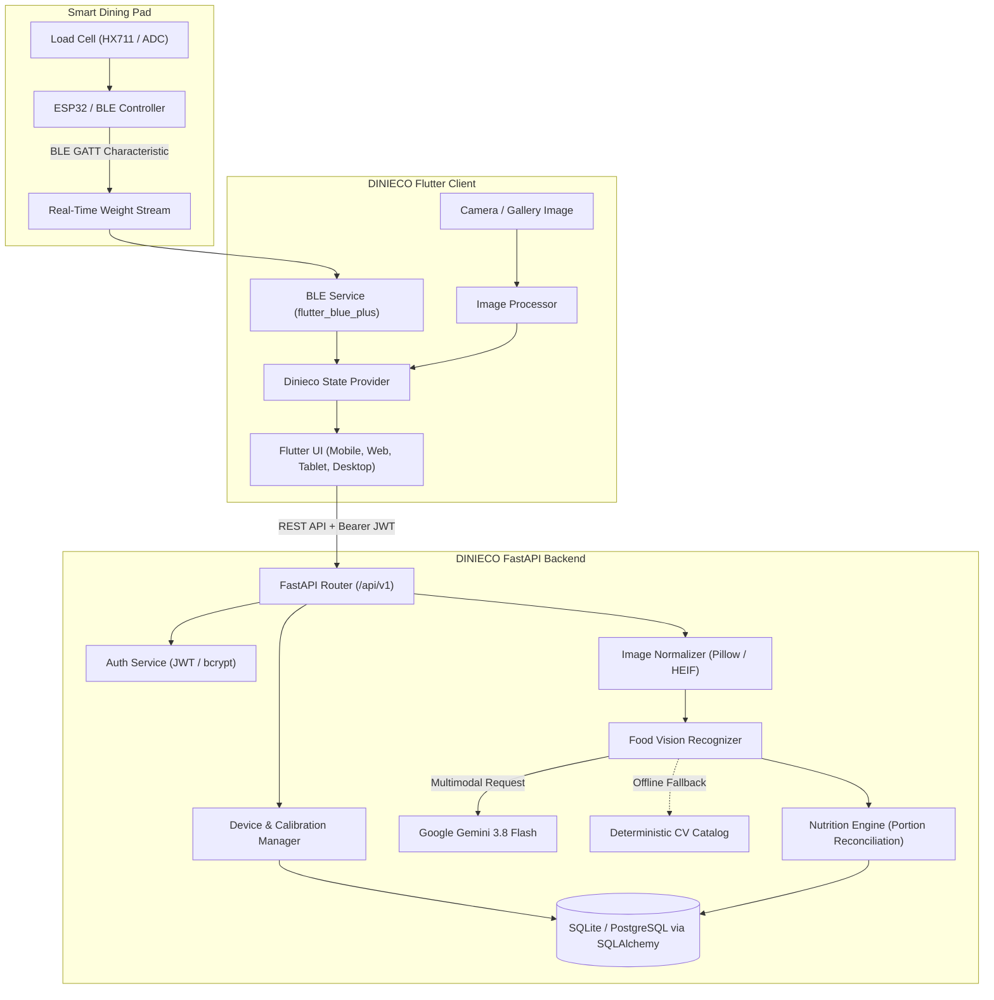

# DINIECO 🍽️🌱
### Smart Dining Pad & AI Food Waste Reduction Platform

[](https://flutter.dev)
[](https://fastapi.tiangolo.com)
[](https://python.org)
[](https://aistudio.google.com/)
[](LICENSE)
[]()

**DINIECO** is an integrated IoT and AI-powered smart dining ecosystem designed to eliminate plate food waste, automate nutritional tracking, and quantify environmental sustainability. 

By coupling a Bluetooth Low Energy (**BLE**) Smart Dining Pad with live load cell weight telemetry and multimodal **Google Gemini AI Computer Vision**, DINIECO decomposes meals into individual ingredients, calculates portion-accurate macronutrients, tracks real-time eating sessions, and computes precise post-meal waste metrics (including avoided $\text{CO}_2$ emissions, water conservation, and monetary savings).

---

## 📑 Table of Contents

- [Key Features](#-key-features)
- [System Architecture](#-system-architecture)
- [Tech Stack](#-tech-stack)
- [Repository Structure](#-repository-structure)
- [Getting Started & Setup](#-getting-started--setup)
  - [Prerequisites](#prerequisites)
  - [1. Backend Setup (FastAPI)](#1-backend-setup-fastapi)
  - [2. Mobile & Web Client Setup (Flutter)](#2-mobile--web-client-setup-flutter)
- [API Documentation](#-api-documentation)
- [Smart Dining Pad Hardware & BLE Protocol](#-smart-dining-pad-hardware--ble-protocol)
- [Testing & Quality Assurance](#-testing--quality-assurance)
- [Screenshots & UI Design](#-screenshots--ui-design)
- [Contributing](#-contributing)
- [License](#-license)

---

## ✨ Key Features

- ⚖️ **Smart Dining Pad BLE Connectivity**: Pairs seamlessly with ESP32/nRF-based smart dining pads via Bluetooth Low Energy (`flutter_blue_plus`). Streams real-time gross weight, tare offsets, and plate tare deductions.
- 🎯 **Multi-Step Hardware Calibration Wizard**: Built-in 4-step guided calibration (Unloaded Zero Tare, Standard 500g Test Mass, Stability Verification, and EEPROM saving) ensures sub-gram precision ($\pm 0.5\text{g}$).
- 👁️ **AI Multi-Component Vision**: Captures or uploads meal photographs across all formats (JPEG, PNG, WEBP, HEIC/HEIF). Utilizes **Google Gemini Vision** to segment meals into distinct food components with individual visual portion ratios and preparation styles.
- 🥗 **Deterministic Nutritional Engine**: Fallback catalog ensures 100% offline uptime when cloud AI is unreachable. Accurately estimates calories, proteins, carbohydrates, fats, and dietary fibers reconciled against actual weighed grams.
- ⏱️ **Live Active Meal Session**: Real-time circular gauge displays weight reduction dynamically as the meal progresses, handling mid-meal tare and disconnection recovery gracefully.
- 📉 **Post-Meal Waste & Eco-Impact**: Compares pre-meal food mass with post-meal residual scraps to calculate waste percentage, carbon footprint impact ($\text{kg CO}_2\text{e}$), water footprint saved (liters), and financial losses.
- 📊 **Tablet Analytics Dashboard**: Comprehensive historical visualization of dining habits, weekly waste trends, and average meal composition for institutional cafeterias or personal wellness.
- 🔐 **Secure JWT Authentication**: Role-ready authentication with token expiration, encrypted credentials, and secure local session persistence.

---

## 🏗️ System Architecture



---

## 🛠️ Tech Stack

### Frontend (Flutter Client)
- **Framework**: [Flutter](https://flutter.dev) (Dart 3.x)
- **State Management**: [`provider`](https://pub.dev/packages/provider)
- **Bluetooth Low Energy**: [`flutter_blue_plus`](https://pub.dev/packages/flutter_blue_plus)
- **HTTP Client**: [`http`](https://pub.dev/packages/http) & [`http_parser`](https://pub.dev/packages/http_parser)
- **Image Picker & Media**: [`image_picker`](https://pub.dev/packages/image_picker)
- **Persistent Storage**: [`shared_preferences`](https://pub.dev/packages/shared_preferences)
- **Design & Theming**: Custom Dinieco Theme with light/dark adaptive palettes and responsive tablet shell

### Backend (REST API)
- **Web Framework**: [FastAPI](https://fastapi.tiangolo.com/) (ASGI via Uvicorn)
- **Language**: Python 3.10+
- **Database ORM**: [SQLAlchemy 2.0](https://www.sqlalchemy.org/)
- **Data Validation**: [Pydantic v2](https://docs.pydantic.dev/)
- **AI & Computer Vision**: [Google GenAI SDK](https://github.com/google-gemini/generative-ai-python) (`google-genai`), Pillow (`PIL`), `pillow-heif`
- **Security**: PyJWT, OAuth2 Bearer Tokens
- **Testing**: Pytest, HTTPX, JMeter, Selenium SIDE runner

---

## 📁 Repository Structure

```text
Dinieco/
├── backend/                        # FastAPI REST API & Computer Vision Service
│   ├── app/
│   │   ├── api/                    # Route handlers
│   │   │   ├── auth.py             # User signup, login, profile
│   │   │   ├── device.py           # Pad telemetry & battery endpoints
│   │   │   ├── calibration.py      # Zero tare & mass calibration
│   │   │   ├── vision.py           # Image upload & Gemini/CV recognition
│   │   │   ├── nutrition.py        # Nutritional lookup & calculations
│   │   │   ├── meals.py            # Meal session lifecycle & storage
│   │   │   ├── analytics.py        # Aggregate dining & waste stats
│   │   │   └── insights.py         # Environmental impact & savings
│   │   ├── core/                   # Configuration, database engine & security
│   │   │   ├── config.py
│   │   │   ├── database.py
│   │   │   └── security.py
│   │   ├── models/                 # SQLAlchemy ORM models
│   │   │   ├── user.py
│   │   │   └── meal.py
│   │   ├── schemas/                # Pydantic request/response schemas
│   │   │   ├── user.py
│   │   │   ├── meal.py
│   │   │   └── device.py
│   │   ├── services/               # Core business & algorithmic logic
│   │   │   ├── vision_recognizer.py# Gemini multimodal & CV portion engine
│   │   │   ├── nutrition_engine.py # Macro/micronutrient portion scaling
│   │   │   ├── image_normalizer.py # Cross-format image sanitizer & converter
│   │   │   └── waste_calculator.py # Food waste & eco-impact formulas
│   │   └── main.py                 # FastAPI application entrypoint & auto-migration
│   ├── tests/                      # 57 automated backend unit & integration tests
│   ├── requirements.txt            # Python dependencies
│   └── .env.example                # Template environment variables
├── lib/                            # Flutter Client Application
│   ├── core/                       # App colors, themes & global constants
│   ├── models/                     # Dart data models (MealSession, Component, BLE)
│   ├── providers/                  # ChangeNotifiers (DiniecoProvider, BLEProvider, AuthProvider)
│   ├── screens/                    # Application UI Views
│   │   ├── auth/                   # Login & Registration screens
│   │   ├── home_dashboard_screen.dart # Central overview & quick stats
│   │   ├── active_session_screen.dart # Live dining session with weight gauge
│   │   ├── post_meal_summary_screen.dart # Post-meal waste analysis & eco impact
│   │   ├── hardware_connectivity_screen.dart # BLE device discovery & pairing
│   │   ├── diagnostics_calibration_screen.dart # Guided load-cell tare wizard
│   │   ├── tablet_analytics_screen.dart # Tablet-optimized historical trends
│   │   └── main_shell.dart         # Responsive navigation scaffold
│   ├── services/                   # BLE & HTTP communication clients
│   │   ├── api_service.dart
│   │   ├── auth_service.dart
│   │   └── ble_service.dart
│   ├── widgets/                    # Reusable custom UI components
│   └── main.dart                   # Flutter app entrypoint
├── test/                           # 58 automated Flutter widget & flow tests
├── designs/                        # UI/UX design specifications & screen previews
├── pubspec.yaml                    # Flutter dependencies & metadata
└── README.md                       # Comprehensive project documentation
```

---

## 🚀 Getting Started & Setup

### Prerequisites

Ensure you have the following installed on your machine:
- **Git**: [Download Git](https://git-scm.com/)
- **Python**: Version 3.10, 3.11, 3.12, or 3.13 ([Download Python](https://www.python.org/))
- **Flutter SDK**: Version 3.13+ ([Install Flutter](https://docs.flutter.dev/get-started/install))
- **Google Gemini API Key** *(Optional)*: Get a free API key at [Google AI Studio](https://aistudio.google.com/). If omitted, DINIECO automatically falls back to its deterministic food CV catalog.

---

### 1. Backend Setup (FastAPI)

1. **Navigate to the backend directory**:
   ```bash
   cd backend
   ```

2. **Create and activate a virtual environment**:
   - **Windows (PowerShell)**:
     ```powershell
     python -m venv venv
     .\venv\Scripts\Activate.ps1
     ```
   - **macOS / Linux**:
     ```bash
     python3 -m venv venv
     source venv/bin/activate
     ```

3. **Install dependencies**:
   ```bash
   pip install -r requirements.txt
   ```

4. **Configure Environment Variables**:
   Copy the example `.env.example` file to `.env`:
   ```bash
   # Windows (PowerShell):
   Copy-Item .env.example .env

   # macOS / Linux:
   cp .env.example .env
   ```
   *(Optional)* Open `.env` and paste your Gemini API key:
   ```dotenv
   GEMINI_API_KEY=AIzaSy...your_gemini_key_here
   ```

5. **Start the FastAPI server**:
   ```bash
   uvicorn app.main:app --host 127.0.0.1 --port 8000 --reload
   ```

6. **Verify the Backend**:
   - API Status: Open [http://127.0.0.1:8000](http://127.0.0.1:8000)
   - Interactive Swagger Docs: Open [http://127.0.0.1:8000/docs](http://127.0.0.1:8000/docs)
   - Alternative ReDoc: Open [http://127.0.0.1:8000/redoc](http://127.0.0.1:8000/redoc)

---

### 2. Mobile & Web Client Setup (Flutter)

1. **Return to the root directory**:
   ```bash
   cd ..
   ```

2. **Install Flutter packages**:
   ```bash
   flutter pub get
   ```

3. **Configure API Base URL** *(if testing on an external mobile device or emulator)*:
   - By default, `lib/services/api_service.dart` targets `http://127.0.0.1:8000`.
   - For Android Emulator: Use `http://10.0.2.2:8000`.
   - For physical phone over Wi-Fi: Set your local LAN IP (e.g., `http://192.168.1.50:8000`).

4. **Run the Flutter Application**:
   - **Web (Chrome)**:
     ```bash
     flutter run -d chrome
     ```
   - **Windows Desktop**:
     ```bash
     flutter run -d windows
     ```
   - **Android / iOS Device**:
     ```bash
     flutter run
     ```

---

## 📡 API Documentation

DINIECO provides a modular RESTful API under the `/api/v1` route prefix. 

| Method | Endpoint | Description | Auth Required |
|:---|:---|:---|:---:|
| `POST` | `/api/v1/auth/register` | Register new dining user account | No |
| `POST` | `/api/v1/auth/login` | Authenticate & retrieve JWT access token | No |
| `GET` | `/api/v1/auth/me` | Fetch active user profile and preferences | Yes |
| `GET` | `/api/v1/device/status` | Read pad connectivity, battery %, & tare weight | Optional |
| `POST` | `/api/v1/calibration/tare` | Zero out the load cell platform tare weight | Yes |
| `POST` | `/api/v1/calibration/calibrate`| Run 2-point reference calibration step | Yes |
| `POST` | `/api/v1/vision/upload` | Upload meal photo (JPEG, PNG, HEIC, WEBP) | Yes |
| `POST` | `/api/v1/vision/analyze` | AI multi-component food recognition & portion ratios | Yes |
| `POST` | `/api/v1/nutrition/calculate` | Compute calorie & macro breakdown for components | Yes |
| `POST` | `/api/v1/meals/start` | Initialize active meal session with gross weight | Yes |
| `POST` | `/api/v1/meals/complete` | Complete meal, compute residual waste & eco impact | Yes |
| `GET` | `/api/v1/meals/history` | Retrieve user's historical dining records | Yes |
| `GET` | `/api/v1/analytics/overview` | Fetch cumulative waste and meal efficiency metrics | Yes |
| `GET` | `/api/v1/insights/environmental`| Retrieve $\text{CO}_2$ avoided, water saved, and money saved | Yes |

Full interactive schemas, request payloads, and testing sandbox are available at `/docs` when the backend is running.

---

## 🔌 Smart Dining Pad Hardware & BLE Protocol

The DINIECO Smart Pad communicates via standard BLE GATT profiles:

- **Service UUID**: `0000ffe0-0000-1000-8000-00805f9b34fb`
- **Telemetry Characteristic UUID**: `0000ffe1-0000-1000-8000-00805f9b34fb`
  - **Properties**: Read, Notify
  - **Payload Format**: Binary or ASCII JSON containing:
    ```json
    {
      "weight_g": 482.5,
      "is_stable": true,
      "battery_pct": 94,
      "device_id": "DINIECO-PAD-001"
    }
    ```
- **Control Characteristic UUID**: `0000ffe2-0000-1000-8000-00805f9b34fb`
  - **Commands**: `TARE`, `CAL_START`, `CAL_PASS`, `SLEEP`

---

## 🧪 Testing & Quality Assurance

DINIECO maintains comprehensive unit, integration, and UI test suites across both backend and frontend.

### Running Backend Tests (Pytest)
```bash
cd backend
python -m pytest -v
```
- **Test coverage includes**:
  - Image normalization across JPEG, PNG, WEBP, BMP, TIFF, GIF, AVIF, HEIC
  - Dual weight modes (Automatic Smart Pad subtraction vs. Manual input)
  - Mathematical portion reconciliation ($\sum w_i = W_{\text{net}}$)
  - Boundary limits (10g min, 2500g max, negative weight rejection)
  - JWT authorization and meal database lifecycle

### Running Frontend Tests (Flutter)
```bash
flutter test
```
- **Test coverage includes**:
  - BLE packet parsing and checksum validation
  - Mid-session disconnect and lifecycle recovery from `SharedPreferences`
  - Dual weight mode toggle and camera photo retake flows
  - Navigation smoke tests and interactive CTAs
  - Accessibility and layout rendering across mobile and tablet viewports

---

## 🎨 Screenshots & UI Design

DINIECO features a modern design with an emerald-amber palette tailored for high-contrast dining environments:

| Home Dashboard | Active Dining Session | Post-Meal Waste Summary |
|:---:|:---:|:---:|
| Quick overview of today's meals, calorie targets, and waste metrics. | Live weight reduction gauge, food breakdown, and dynamic component tracking. | Waste audit showing residual food scraps, carbon offset, and water conserved. |

| Hardware Calibration Wizard | Tablet Analytics Dashboard |
|:---:|:---:|
| 4-step guided zero-tare and reference mass calibration for load-cell sensors. | Split-screen analytics view designed for wall displays and tablets. |

*(Design wireframes and interactive mockups are available in the [`designs/`](designs/) directory).*

---

## 🤝 Contributing

Contributions are welcome! Please follow these steps:

1. Fork the repository.
2. Create your feature branch (`git checkout -b feature/AmazingFeature`).
3. Commit your changes (`git commit -m 'Add some AmazingFeature'`).
4. Push to the branch (`git push origin feature/AmazingFeature`).
5. Open a Pull Request.

Please ensure all backend tests (`pytest`) and Flutter tests (`flutter test`) pass before submitting your PR.

---

## 📄 License

This project is licensed under the MIT License - see the [LICENSE](LICENSE) file for details.

---

**Built with passion for sustainable dining and food waste reduction.** 🌱
